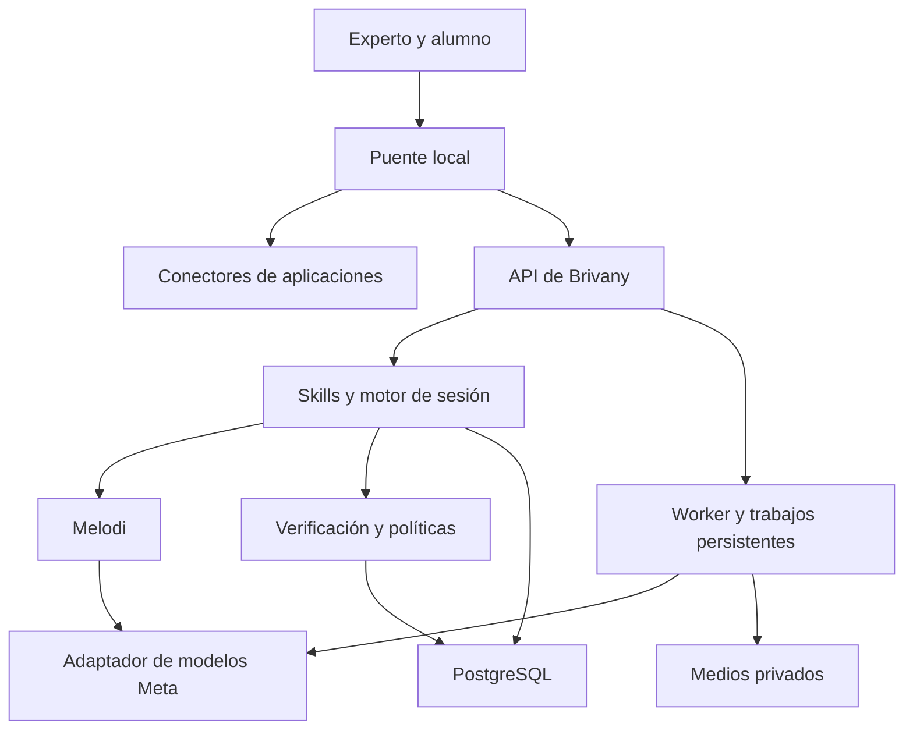
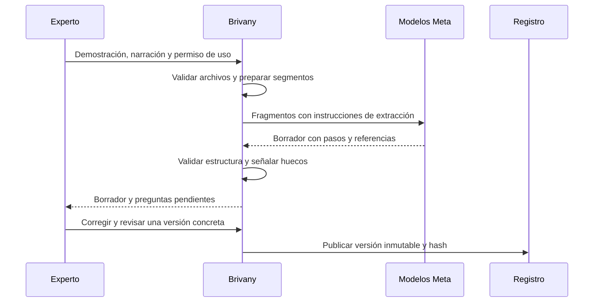
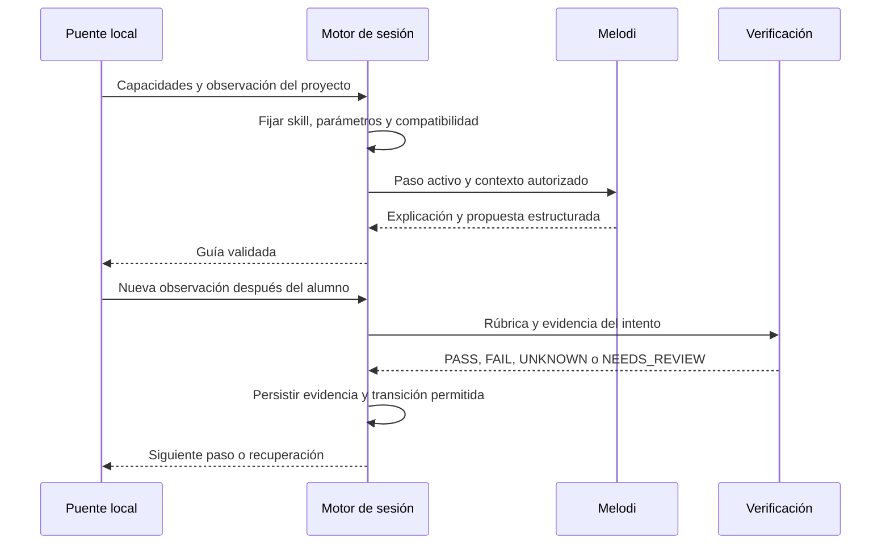

# 2. Arquitectura del sistema

## 2.1 Organización general

Brivany parte de un monolito modular con tres unidades de ejecución: API de coordinación, worker de procesamiento y puente de escritorio. PostgreSQL conserva los estados; el almacenamiento de objetos conserva medios y evidencia. Los límites entre módulos permiten separar servicios cuando las mediciones lo justifiquen.

El diagrama representa componentes internos. No especifica pantallas ni interacción gráfica. En implementación, la captura de medios utiliza autorizaciones de carga de corta duración hacia el almacén; los bytes de video no atraviesan cada módulo de la API.

## 2.2 Límites de confianza

| Zona | Datos y capacidades | Regla |
|---|---|---|
| Equipo del usuario | Aplicación profesional, documentos, ventanas y conector | Captura y acciones limitadas a la sesión autorizada |
| Backend Brivany | Identidad, skills, sesiones, evidencia, colas | Todas las consultas quedan asociadas a un espacio y un actor |
| Proveedor de modelos | Fragmentos seleccionados de contexto | Recibe únicamente lo necesario; no posee permisos de escritorio |
| Contenido de terceros | Videos, documentos, texto en pantalla y skills importadas | Se procesa como datos sin autoridad para ejecutar instrucciones |
| Revisor experto | Aprobación de contenido y rúbricas | Firma lógica de la revisión vinculada al hash de la versión |

La captura de pantalla no es una orden. Una propuesta de Melodi tampoco es una autorización de ejecución.

## 2.3 Módulos

| Módulo | Responsabilidad | No debe hacer |
|---|---|---|
| Identidad y espacios | Usuarios, miembros, roles, dispositivos y permisos | Inferir un espacio desde texto generado por IA |
| Capturas y medios | Carga, metadatos, redacción, hash, retención | Abrir acceso general a documentos locales |
| Compilador de skills | Segmentar demostraciones, extraer pasos, adjuntar fuentes | Publicar automáticamente una skill |
| Registro de skills | Versiones, revisión, compatibilidad y distribución | Modificar una versión publicada en silencio |
| Motor de sesión | Estado, pasos activos, intentos, pausas, nivel de ayuda | Delegar transiciones autoritativas al modelo |
| Melodi | Explicar, preguntar, proponer alternativas y herramientas | Otorgarse permisos o certificar sus propias respuestas |
| Verificación | Aplicar rúbricas y combinar evidencia admisible | Confundir ausencia de evidencia con éxito |
| Política de acciones | Alcance, riesgo, permisos, precondiciones y presupuesto | Ejecutar texto de la skill como código |
| Registro de conectores | Capacidades por aplicación, versión y plataforma | Suponer compatibilidad por nombre de programa |
| Evaluación | Intentos de práctica y transferencia | Contar una acción del agente como dominio del alumno |
| Observabilidad | Trazas, métricas, costos y auditoría | Registrar por defecto imágenes o secretos en logs |

## 2.4 Flujo de creación

1. El experto elige una aplicación y recursos que puede compartir.
2. El puente captura la ventana, audio autorizado y observaciones nativas disponibles. Los eventos no son un keylogger global.
3. La API crea un trabajo persistente. El worker extrae audio y fotogramas y establece una línea temporal común.
4. Meta propone pasos, condiciones y preguntas. Cada inferencia conserva su fuente o se marca como propuesta sin confirmar.
5. El compilador comprueba contratos y coherencia; no ejecuta código del contenido.
6. El experto corrige las omisiones y define criterios y variantes.
7. Una revisión aprobada se vincula al hash del contenido. Cualquier cambio invalida esa aprobación.
8. Publicación crea una versión inmutable que puede utilizarse en sesiones.

## 2.5 Flujo de aprendizaje

La sesión fija una versión de skill y un perfil de conector. Un cambio de versión de la aplicación provoca una nueva comprobación de compatibilidad. La versión de skill no se sustituye mientras la sesión está en marcha.

## 2.6 Ejecución de una demostración opcional

Cuando el alumno solicita que Melodi muestre una acción:

1. Melodi propone una operación registrada y sus argumentos.
2. La política verifica modo, permisos, aplicación activa, proyecto y antigüedad de la observación.
3. Una operación que requiere confirmación queda pendiente con alcance y vencimiento concretos.
4. El puente comprueba nuevamente el estado local, registra el comando y actúa en una copia o contexto recuperable.
5. El conector devuelve resultado y nueva observación.
6. La verificación comprueba la poscondición. Un retorno exitoso de la herramienta no implica que el alumno haya aprendido.

El modo de enseñanza inicial deja las acciones en manos del alumno. Las operaciones del agente se contabilizan aparte y no aumentan su nivel de dominio.

## 2.7 Stack propuesto

| Capa | Selección inicial | Motivo |
|---|---|---|
| API | Python y FastAPI | Contratos tipados e integración con tareas de medios y conectores |
| Contratos | Pydantic y JSON Schema | Definición explícita, validación y documentación |
| Base de datos | PostgreSQL | Transacciones, relaciones, JSONB y aislamiento entre espacios |
| Trabajos | Tabla de trabajos con lease y outbox transaccional | Recuperación y auditoría sin añadir un broker al prototipo |
| Archivos | Almacenamiento privado compatible con S3 | Medios grandes separados de las transacciones |
| Sesiones | HTTP para operaciones durables; WebSocket para notificaciones y puente | Reconexión y recuperación desde la base de datos |
| Puente de escritorio | Proceso Python firmado y empaquetado en la implementación | Integración inicial con Resolve y Blender |
| AutoCAD | Adaptador .NET en proceso y canal local autenticado | Acceso a entidades y eventos mediante la API correspondiente |
| Identidad | Proveedor OIDC; backend valida tokens | Evitar construir un sistema de contraseñas |
| Telemetría | OpenTelemetry o equivalente | Trazas por sesión, conector y llamada de modelo |

Se fijarán versiones y archivos de dependencias al iniciar la implementación. Este diseño no declara compatible una combinación de versiones no ensayada.

## 2.8 Trabajos, concurrencia y recuperación

- El estado de sesión y su evento de salida se guardan en una misma transacción. El outbox permite reenviar notificaciones sin perder cambios.
- Los workers reclaman trabajos con un lease, renuevan su heartbeat y recuperan los vencidos. Los trabajos no se almacenan únicamente en memoria.
- La entrega es al menos una vez. Cada consumidor deduplica por identificador. No se promete ejecución exactamente una vez en una interfaz de escritorio.
- Cada actualización de sesión exige la revisión esperada; una escritura concurrente devuelve conflicto y obliga a recuperar el estado.
- Un comando lleva identificador estable, revisión observada, proyecto, vencimiento y clave de idempotencia. El puente conserva un journal local.
- Si el proceso se interrumpe después de modificar la aplicación y antes de confirmar el resultado, el comando queda `uncertain`. Se reconcilia leyendo la aplicación; no se repite a ciegas.
- El WebSocket transporta avisos. Tras desconexión, el cliente recupera eventos por cursor; un aviso perdido no borra el progreso.

## 2.9 Despliegue y crecimiento

Primera etapa: una instancia de API, un worker, PostgreSQL administrado, almacén de objetos y un puente local por alumno. La GPU de la aplicación creativa permanece en el equipo del usuario; usar un modelo en la nube no elimina el costo de renderizar o editar.

Al crecer, se separan workers de medios y de evaluación, se particiona evidencia por antigüedad y se escalan sesiones por espacio. Si aparecen múltiples instancias de WebSocket, un bus distribuye avisos; PostgreSQL sigue conservando el estado. Un motor de workflows o broker dedicado se incorpora cuando la cola, los tiempos o los reintentos lo justifiquen.

El registro de skills y el motor de aprendizaje no deben importar código de DaVinci, AutoCAD o Blender. Sus dependencias son los contratos de conectores. Esa regla permite ampliar especialidades sin duplicar el producto.

## 2.10 Organización del código a implementar

Esta estructura es el destino propuesto de la implementación. El paquete actual contiene documentación y contratos; estas aplicaciones todavía no están creadas.

| Ruta propuesta | Responsabilidad |
|---|---|
| `services/api` | Endpoints, identidad y coordinación |
| `services/worker` | Ingesta, compilación y evaluación asíncrona |
| `packages/skills` | Versiones, manifiestos, revisión y publicación |
| `packages/sessions` | Estado de aprendizaje y transiciones |
| `packages/melodi` | Contexto, prompts y propuestas pedagógicas |
| `packages/verification` | Rúbricas y verificadores registrados |
| `packages/policy` | Alcance de permisos y autorización de acciones |
| `packages/providers` | Adaptadores de los modelos |
| `desktop_bridge` | Captura autorizada y ejecución local |
| `connectors` | Adaptadores de Resolve, Blender y AutoCAD |
| `infra` | Migraciones, configuración y despliegue |
| `tests/integration` | Pruebas reales de conectores y recuperación |

