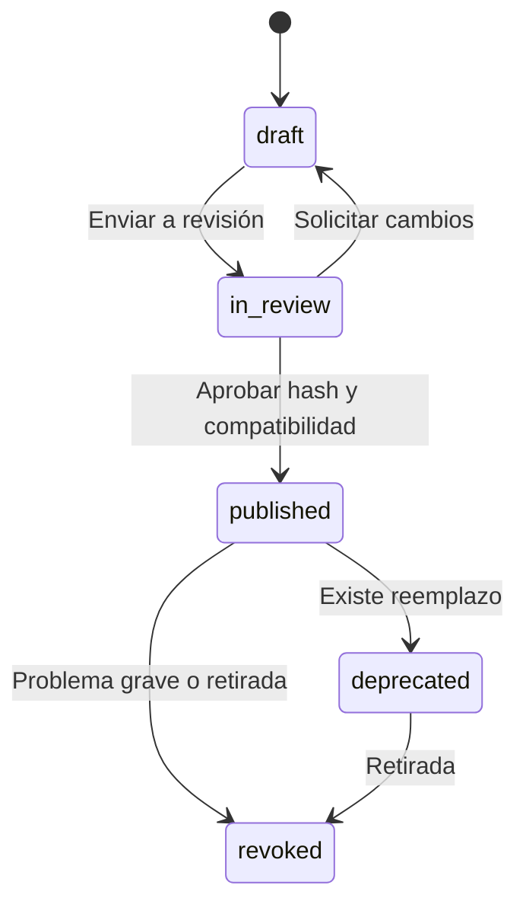

# 3. Skills y aprendizaje

## 3.1 Unidad de contenido

Una skill representa un objetivo delimitado. Una profesión se organiza como una colección de skills y prerrequisitos, no como un único procedimiento universal. El autor explicita qué condiciones hacen válida cada skill.

Ejemplos: preparar una línea de tiempo para una entrega, igualar exposición dentro de condiciones definidas, construir una pieza con dimensiones dadas o dibujar una planta usando unidades y capas establecidas.

## 3.2 Contenido del manifiesto

| Campo | Propósito |
|---|---|
| Identidad | `skill_id`, versión semántica y versión de esquema |
| Objetivo | Resultado esperado y conocimientos previos |
| Dominio | Edición, colorización, CAD, modelado u otro registrado |
| Compatibilidad | Aplicación, versiones ensayadas, plataforma y capacidades necesarias |
| Parámetros | Datos que pueden variar: dimensiones, unidades o perfil de entrega |
| Fuentes | Recursos autorizados, hash y tramos de la demostración |
| Pasos | Intención, instrucciones, dependencias y evidencias esperadas |
| Rúbricas | Comprobaciones deterministas, visuales o de experto |
| Recuperación | Errores previstos, preguntas y límite de reintentos |
| Transferencia | Ejercicio distinto al ejemplo y condiciones de ayuda |
| Revisión | Responsable, fecha y hash exacto del contenido aprobado |
| Distribución | Visibilidad privada inicial y condiciones de uso |

Los esquemas son una representación versionada de este contrato. Los datos específicos de una aplicación se expresan con claves semánticas registradas por el conector; no se mezclan llamadas de SDK con instrucciones pedagógicas.

## 3.3 Pasos y grafo de ejecución

Cada paso declara una intención y una lista `requires` con pasos previos. El grafo es acíclico. En la primera versión, todos los pasos incluidos deben terminar antes de completar la sesión; los pasos independientes pueden realizarse en el orden permitido.

Las variaciones iniciales se resuelven antes de comenzar: se validan parámetros y se selecciona una variante revisada. La sesión conserva el manifiesto y los parámetros resueltos. Las bifurcaciones dinámicas complejas quedan para una ampliación del esquema; no se ocultan en texto libre.

Un error produce otro intento del mismo paso, con un máximo explícito. Una alternativa que cambie el procedimiento fuera de lo aprobado exige pausa y revisión; Melodi puede proponerla, pero no alterar silenciosamente la skill publicada.

## 3.4 Ciclo de vida

`draft` admite cambios. `in_review` fija una revisión del borrador. `published` es inmutable. Una actualización crea otra versión. Una versión `deprecated` puede terminar sesiones existentes si sigue siendo válida; una versión `revoked` bloquea nuevas sesiones y pausa las activas para informar el motivo.

El hash del contenido se calcula sobre JSON canónico con claves ordenadas y serialización UTF-8, excluyendo `content_sha256`, `review` y `lifecycle`. El contrato de referencia implementa esa misma función. La revisión aprobada debe referir al hash actual. Esta comprobación detecta cambios, pero no sustituye la autenticación del revisor ni una firma criptográfica de publicación.

## 3.5 Fuentes y autoría

Cada paso referencia al menos una fuente: tramo del video del experto, manual autorizado o criterio que el experto haya documentado expresamente. Las instrucciones propuestas por el modelo se señalan como inferencias durante el borrador y deben ser aceptadas por el revisor.

Los manifiestos contienen referencias a recursos, no URLs temporales de descarga. Los medios se resuelven con permisos al abrir la sesión. La skill publicada no expone el proyecto privado del experto a todos sus alumnos.

Una adaptación entre espacios usa una copia autorizada o una licencia sobre la versión. Las sesiones mantienen el identificador de la versión de origen y el hash. La base de datos no concede acceso cruzado al medio original por el simple hecho de conocer su identificador.

## 3.6 Verificación y evidencia

| Resultado | Significado | Comportamiento |
|---|---|---|
| `PASS` | Se cumple la rúbrica con evidencia admisible y vigente | Puede cerrar el paso |
| `FAIL` | Una comprobación contradice el objetivo | Explicar y permitir otro intento |
| `UNKNOWN` | Falta acceso, visibilidad o datos fiables | Pedir evidencia o cambiar al modo humano permitido |
| `NEEDS_REVIEW` | La evidencia requiere juicio experto o presenta discrepancias | Mantener el paso pendiente |

Cada rúbrica declara el tipo de evidencia que admite. Una comprobación nativa solo pasa con un valor leído por el conector autorizado o calculado por un verificador registrado. Un mensaje del alumno no sustituye esa lectura. Una valoración artística requiere la rúbrica experta correspondiente.

Las evaluaciones visuales de un modelo generan candidatos y explicaciones. Durante la primera versión, no producen por sí solas un `PASS` autoritativo. Un revisor o un dato independiente debe resolver el caso. Un umbral de confianza declarado por el modelo no es una probabilidad calibrada.

La falta de dato y el valor cero son estados diferentes. Una observación antigua, de otro proyecto o de otro intento no puede utilizarse para aprobar un paso actual.

## 3.7 Condiciones y unidades

Las reglas iniciales usan un conjunto cerrado de operadores: igualdad, presencia, mayor o igual, menor o igual y proximidad numérica con tolerancia. El valor esperado puede ser literal o un parámetro de la skill, nunca ambos.

Los conectores normalizan unidades y explican su origen. Por ejemplo, una medida en metros debe incorporar la escala de unidades de la escena; no basta con copiar el tamaño numérico de un objeto. Una comparación incompatible en unidades devuelve `UNKNOWN`.

No se ejecutan expresiones Python, JavaScript o AutoLISP guardadas en un manifiesto. Los cálculos complejos son verificadores implementados, revisados y registrados por Brivany.

## 3.8 Aprendizaje y reducción de ayuda

El modo pedagógico y el permiso de acción son conceptos separados.

| Nivel de ayuda | Acompañamiento |
|---|---|
| `guided` | Explicación completa, referencias y comprobación por paso |
| `hinted` | Objetivo y pistas cuando sean necesarias |
| `independent` | Ejercicio nuevo; ayuda limitada y registrada |

Una sesión puede terminar correctamente con ayuda completa. Ese resultado se registra como tarea completada, no como dominio independiente. El progreso de competencia requiere varios intentos y, como mínimo, una tarea de transferencia distinta, revisada con la rúbrica apropiada.

El registro de aprendizaje conserva habilidad, versión, variante, nivel de ayuda, errores, intervenciones de Melodi y evaluación final. Evita un único porcentaje que mezcle progreso, confianza del modelo y competencia humana.

## 3.9 Ejemplos del paquete

- `blender-dimensiones.skill.json`: ejemplo revisado sintético. Cambia dimensiones mediante parámetros y usa lecturas del conector. Su revisión de muestra no representa aprobación de una persona real.
- `davinci-color.skill.json`: borrador de colorización con revisión pendiente. Expone los puntos que requerirán evidencia experta antes de poder publicarse.

Los ejemplos no son cursos terminados. Definen cómo representar instrucciones, fuentes, límites y criterios para que la implementación pueda utilizar el mismo motor en distintas especialidades.

