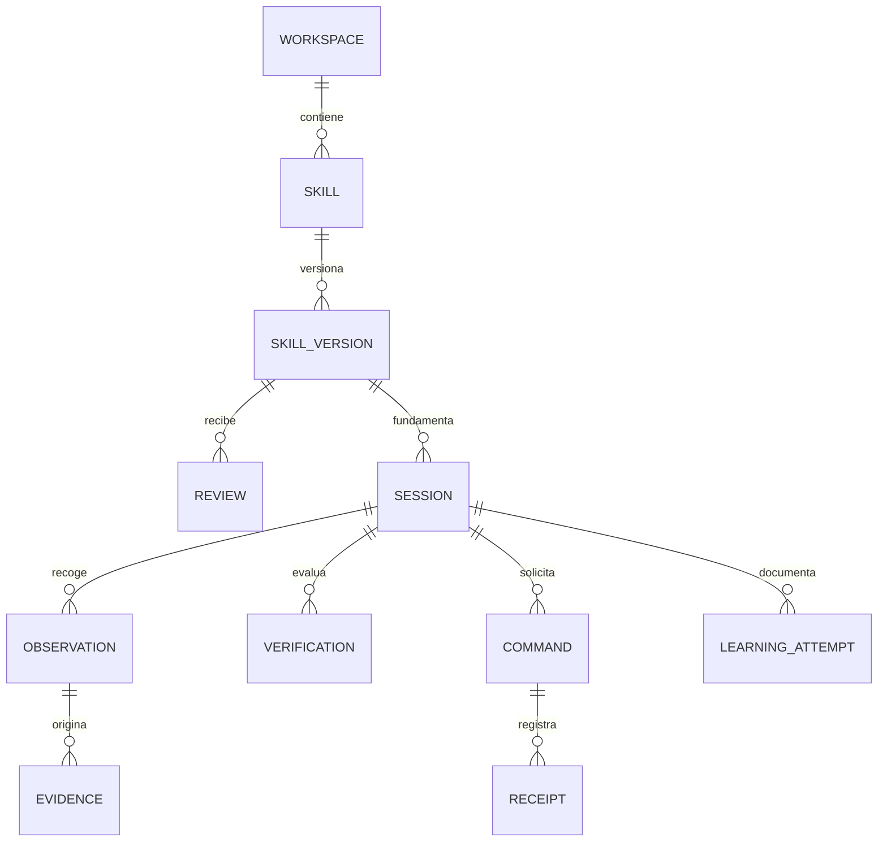

# 6. Datos, API y eventos

## 6.1 Modelo lógico

El modelo detallado está en `data/model.dbml`. Es diseño relacional; no es una migración desplegada.

Cada entidad de un espacio lleva `workspace_id`. Las relaciones entre entidades usan claves compuestas que incluyen ese campo para impedir referencias cruzadas accidentales. Usuarios e identidad global tienen un tratamiento separado de la pertenencia a espacios.

El JSON del manifiesto permite evolución de contenido; identidad, estado, versión, propietario y hash permanecen como columnas consultables. No se almacena toda la aplicación únicamente como documentos JSON.

## 6.2 Entidades y propiedad

| Entidad | Contenido | Autoridad de escritura |
|---|---|---|
| Artifact | Medio privado, hash, tipo, tamaño, procedencia y retención | Servicio de medios tras validar la carga |
| Capture | Sesión de demostración y recursos asociados | Creador autorizado y proceso de captura |
| SkillVersion | Manifiesto inmutable publicado o revisión de borrador | Registro de skills |
| Review | Decisión del revisor sobre un hash concreto | Persona autenticada con rol permitido |
| ConnectorProfile | Compatibilidad y capacidades verificadas | Registro de conectores |
| Session | Versión, parámetros, modo, revisión y presupuesto | Motor de sesión |
| Observation | Hechos recibidos de un dispositivo autenticado | Puente autorizado para esa sesión |
| Evidence | Referencias a señales, recursos y procedencia | Servicio de evidencia |
| Verification | Resultado, rúbrica, intento y evidencias usadas | Verificador autorizado o revisor permitido |
| Command | Operación, guardas, riesgo, autorización y vencimiento | Política de acciones |
| Receipt | Ejecución observada por el conector | Dispositivo al que se asignó el comando |
| LearningAttempt | Resultado y nivel de ayuda | Servicio de evaluación |
| Event / Outbox | Secuencia durable y entregas pendientes | Transacción del módulo propietario |
| Job | Trabajo, lease, intentos y resultado | Worker y coordinador |

Una observación enviada por el puente no se acepta como resultado de evaluación arbitrario. Una llamada del cliente a solicitar verificación no puede incluir un `PASS` que el servidor adopte sin comprobarlo.

## 6.3 Estados de sesión

Estados: `created`, `preflight`, `active`, `paused`, `completed`, `cancelled`, `failed`.

- `created` → `preflight`: fijar versión, dispositivo y parámetros.
- `preflight` → `active`: compatibilidad, permisos y recursos comprobados.
- `active` → `paused`: petición del usuario, pérdida de contexto, presupuesto, conexión o revisión pendiente.
- `paused` → `preflight`: revalidar contexto antes de reanudar.
- `active` → `completed`: todos los pasos obligatorios tienen verificación admisible; el estado de aprendizaje se registra aparte.
- Cualquier estado no terminal → `cancelled`: petición autenticada del usuario.
- Estados no terminales → `failed`: fallo irrecuperable documentado.

Una sesión terminal no recibe nuevas acciones. La repetición crea otra sesión o intento, sin reescribir el historial.

## 6.4 Superficie HTTP

`contracts/openapi.json` documenta la primera superficie. Las rutas llevan `/v1`. La autenticación es Bearer; el espacio solicitado en `X-Workspace-ID` se verifica contra la identidad y el rol, nunca se confía en el encabezado por sí solo.

Grupos de operaciones:

1. Registrar artefactos y obtener una autorización limitada de carga.
2. Registrar capturas y solicitar compilación asíncrona.
3. Crear una versión borrador, leerla, revisarla y publicarla.
4. Crear, consultar, pausar, reanudar o cancelar una sesión; solicitar cambio de modo.
5. Aportar observaciones desde un dispositivo y solicitar verificaciones.
6. Resolver evaluaciones que requieren revisión humana.
7. Solicitar una acción, registrar una decisión y recibir su ejecución.
8. Consultar trabajos y eventos durables.

Identidad OIDC, configuración administrativa y el protocolo completo de emparejamiento se describen en arquitectura y se detallarán al implementar el backend. No se presentan como endpoints ya disponibles.

## 6.5 Semántica HTTP

- Las mutaciones requieren `Idempotency-Key`. La clave se acota por espacio, actor y operación. Se almacena el hash del cuerpo y la respuesta; reutilizar la clave con otro cuerpo produce `409`.
- Las actualizaciones de estado incluyen `expected_revision`. Una revisión incompatible produce `409`; el cliente recupera el estado antes de decidir si repite.
- Una solicitud de trabajo devuelve `202` con `job_id`. El cliente consulta el trabajo o recibe un aviso.
- `401`: identidad no válida. `403`: permiso insuficiente. `404`: recurso inexistente o inaccesible. `422`: contrato o condición inválidos. `429`: límite de consumo. `503`: dependencia no disponible.
- Las respuestas de error tienen código estable, mensaje, identificador de solicitud y detalles no sensibles.
- Las listas usan cursores; ningún endpoint de lectura permite descargar todo el espacio sin límites.
- Una URL temporal no se guarda en la skill. La autorización de descarga se solicita cuando se necesita y no se incluye en logs.

## 6.6 Eventos y WebSocket

El WebSocket autentica al puente mediante credencial acotada y vincula dispositivo, espacio y sesión. No se colocan tokens persistentes en parámetros de URL. El contrato del sobre de eventos está en los esquemas; OpenAPI describe HTTP y no pretende validar todo el canal WebSocket.

El sobre incluye `event_id`, `workspace_id`, `session_id`, `seq`, `type`, `occurred_at`, `correlation_id` y `payload`. `seq` se asigna en servidor y aumenta dentro de cada sesión.

Eventos previstos: `session.started`, `observation.accepted`, `guidance.ready`, `verification.completed`, `command.requested`, `command.completed`, `session.paused`, `session.completed` y `session.cancelled`.

El puente confirma recepción por secuencia. La reconexión solicita eventos posteriores al último cursor confirmado. Los avisos pueden duplicarse; el cliente deduplica por `event_id`. Una observación del dispositivo tiene un identificador propio; no decide su secuencia de servidor.

Los límites iniciales propuestos son 256 KiB por mensaje de control y medios por referencia. Los valores exactos deben verificarse con el transporte elegido. La frecuencia de capturas se ajusta a cambios relevantes; bajo congestión se descartan fotogramas intermedios, preservando la observación más reciente y los eventos durables.

## 6.7 Comandos y decisiones

Un comando contiene herramienta registrada, argumentos, `expected_observation_id`, revisión del proyecto, proyecto autorizado, alcance, vencimiento y política de confirmación. El servidor calcula el hash canónico de la acción; la decisión humana se vincula a ese hash y tiene vencimiento.

Estados: `proposed`, `awaiting_approval`, `authorized`, `dispatched`, `succeeded`, `failed`, `uncertain`, `cancelled`, `expired`. El puente acepta únicamente comandos autorizados para su dispositivo y dentro de su vigencia.

Una aprobación no puede reutilizarse si cambian la herramienta, los argumentos, el proyecto o el riesgo. Para acciones reversibles de bajo riesgo, una autorización acotada de sesión puede ser suficiente; exportar sobre un archivo existente u otra acción irreversible requiere decisión específica.

Un `Receipt` devuelve estado, revisión antes/después y referencias a evidencia. Un éxito de transporte no equivale a éxito de tarea. La poscondición debe verificarse aparte.

## 6.8 Consistencia y retención

Observaciones y evidencia se relacionan con sesión, paso e intento. El verificador comprueba esas relaciones, procedencia, antigüedad y unidad. Las revisiones de proyecto invalidan evidencia usada para una nueva acción cuando el estado pertinente cambió.

Las operaciones de borrado crean trabajos que recorren recursos derivados, transcripciones, índices y copias temporales. Los registros de auditoría conservan la información mínima permitida sin retener el contenido eliminado. La política de retención propuesta está en operación y debe confirmarse antes de producción.

