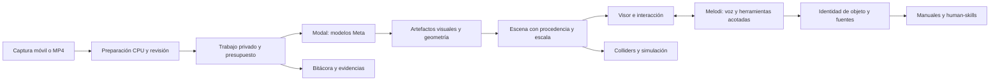

# 15. Plataforma espacial de Brivany

27 de octubre de 2026. Dirección de producto para inmobiliarias y arquitectos, con extensiones posteriores hacia aprendizaje contextual, Meta Glasses y robótica. [Checklist vigente](../PLAN_PLATAFORMA.md).

## Recorrido objetivo

Una persona captura una habitación con su móvil y revisa los fotogramas seleccionados. Melodi coordina un trabajo en la nube para obtener el espacio y unos pocos objetos editables. La persona inspecciona el resultado, comprueba una referencia de escala y mueve objetos; Melodi explica elementos y recupera fuentes o una human-skill vinculada cuando se solicita.

La reconstrucción intensiva se ejecutará en Modal. El ordenador y el móvil conservarán captura, revisión y visualización interactiva. Esto reduce la necesidad de GPU local para inferencia; el visor seguirá dependiendo de las capacidades gráficas del dispositivo.

## Componentes propuestos



| Componente | Función propuesta | Estado |
|---|---|---|
| Preparación local | MP4 limitado → JPEG, hashes y manifiesto | Implementada por CLI, sin evaluación automática de calidad |
| Contrato espacial | Captura, plan, objetos, artefactos, escala y física declarada | Implementado y probado estructuralmente |
| Orquestador | Trabajos, cancelación, presupuesto y reutilización por hash | Pendiente |
| Worker Modal | Inferencia Linux con pesos y dependencias fijados | Pendiente; sin SDK ni sesión configurada en esta fase |
| Reconstrucción | Cámaras/profundidad y objetos seleccionados | Pendiente de primera inferencia |
| Visor | Explorar, seleccionar, transformar y revisar evidencia | Diseño en S2 e implementación en S3 |
| Física | Colliders, cuerpos rígidos y parámetros revisables | Pendiente |
| Melodi | Voz existente y futuras herramientas sobre escena/fuentes | Voz disponible; herramientas espaciales pendientes |
| Bitácora | Actividades, implementaciones, pruebas y evidencias | Implementada en `/activity`; [uso y límites](17-bitacora.md) |

## Modelos y licencias

**SAM 3.1** es candidato para segmentar y seguir objetos, produciendo máscaras que permiten seleccionar elementos. No entrega por sí solo geometría 3D ni la identidad comercial exacta de un aparato. Revisar pesos, acceso y licencia al fijar la versión. [Repositorio oficial SAM 3](https://github.com/facebookresearch/sam3).

**SAM 3D Objects** reconstruye forma, textura y pose de objetos a partir de imagen y máscara. Su carácter generativo permite completar partes no visibles; esas partes deben conservar procedencia de inferencia. Su instalación oficial requiere Linux y una GPU NVIDIA de al menos 32 GB de VRAM, por lo que corresponde a un worker GPU remoto. [Repositorio oficial](https://github.com/facebookresearch/sam-3d-objects), [requisitos de instalación](https://github.com/facebookresearch/sam-3d-objects/blob/main/doc/setup.md), [licencia](https://github.com/facebookresearch/sam-3d-objects/blob/main/LICENSE).

**VGGT-1B-Commercial** es el candidato para cámaras, profundidad y correspondencias entre vistas. El repositorio distingue expresamente el checkpoint comercial del checkpoint original, que conserva restricciones de uso no comercial. Debe fijarse el nombre exacto, el commit y la licencia de los pesos seleccionados. [Repositorio oficial](https://github.com/facebookresearch/vggt), [checkpoint comercial](https://huggingface.co/facebook/VGGT-1B-Commercial).

**VGGT-Ω** se mantiene fuera de la base comercial propuesta por la licencia de investigación no comercial publicada para código y pesos; cualquier evaluación posterior requiere revisar de nuevo sus términos. [Modelo oficial](https://huggingface.co/facebook/VGGT-Omega), [licencia del repositorio](https://raw.githubusercontent.com/facebookresearch/vggt-omega/main/LICENSE).

La selección está documentada y aún no se ha ejecutado. Una API Meta de conversación no sustituye el acceso a checkpoints ni instala estos modelos automáticamente.

## Representación y fidelidad

La escena conservará una representación visual y objetos con transformaciones y referencias a fotogramas. Las mallas editables y los elementos visuales de tipo splat tendrán roles distintos. Las colisiones requieren geometría y parámetros adecuados; una representación visual detallada no demuestra comportamiento físico fiel.

Son conclusiones de ingeniería que un video RGB no determina por sí solo dimensiones absolutas sin referencia, superficies ocultas, peso, inercia, fricción, elasticidad o mecanismos internos. La interfaz debe permitir revisar esas propiedades y señalar su procedencia. La referencia de una puerta medida puede ayudar a calibrar escala después de reconstruir; escribir una longitud en el formulario no certifica que la geometría ya esté calibrada.

Los contratos actuales separan `observed`, `inferred` y `generated`; registran la procedencia de propiedades físicas y exigen evidencia declarada para geometría en metros. Son validaciones de estructura y coherencia, no una certificación de medidas. El estado de escena inicial es `preview_unverified`.

**Rapier** es candidato para interacción física inicial en navegador. **MuJoCo** se evalúa posteriormente para mecanismos, actuadores y simulación robótica. Ambos requieren un modelo físico definido; no reconstruyen automáticamente esas propiedades a partir del video. [Documentación Rapier](https://rapier.rs/docs/), [documentación MuJoCo](https://mujoco.readthedocs.io/en/stable/overview.html).

## Modal y límites de gasto

La primera GPU candidata es L40S de 48 GB, sujeta a comprobar compatibilidad del modelo y sus dependencias. La configuración prevista limita concurrencia a un contenedor, mantiene el mínimo en cero y desactiva reintentos automáticos de la primera prueba. Deben medirse preparación de pesos, arranque, inferencia, almacenamiento y transferencia por separado. [GPU en Modal](https://modal.com/docs/guide/gpu), [escalado de contenedores](https://modal.com/docs/guide/scale).

Los planes locales declaran hasta seis fotogramas por defecto, tres objetos y 180 segundos GPU para la prueba acotada. `dispatch_enabled` es `false`. El límite es una intención contractual pendiente de enforcement; todavía no existe un worker que lo aplique. La primera inferencia real debe resolver una sola pregunta técnica con un objeto: compatibilidad, artefacto válido y coste observado.

La concesión de créditos del hackatón no está confirmada. Solicitud, aprobación, saldo y presupuesto monetario son dependencias pendientes; no se presupone una cantidad ni se ha consumido GPU para este hito.

## Primera implementación y reproducción

Desde la raíz del proyecto en Windows, con `ffmpeg` y `ffprobe` disponibles:

```powershell
.\.venv\Scripts\python.exe -X utf8 -B -m tools.prepare_spatial_capture .\captura.mp4 --output .\.local\captura-espacial-001 --frames 6
```

La carpeta superior de salida debe existir y el destino debe ser nuevo. Puede añadirse una referencia declarada mediante `--reference-length-m 0.8 --reference-description "Ancho medido de la puerta"`. El MP4 admite hasta 60 segundos y 25 MiB; los fotogramas se reducen a 1280 px de lado máximo.

El paquete contiene `capture.json`, `reconstruction-plan.json`, `preflight.json`, `frames/` y `capture-bundle.zip`. El ZIP contiene los tres JSON y los JPEG, sin el video original. El preflight informa duplicados exactos y revisión pendiente; no puntúa nitidez, cobertura ni solapamiento. Los tiempos representan posiciones de búsqueda solicitadas a FFmpeg, no tiempos de presentación medidos con precisión del fotograma.

```powershell
.\.venv\Scripts\python.exe -X utf8 -B -m unittest discover -s tests -p 'test_spatial*.py'
```

La comprobación inicial incluye pruebas de contrato y empaquetado, además de extracción FFmpeg de seis imágenes de una demostración sintética de nueve segundos. No es un cuarto real ni una reconstrucción 3D. No se llamó a Meta ni Modal durante esa comprobación.

## Objetos, fuentes y aprendizaje

Una categoría como «microondas» no identifica un manual. La ruta propuesta necesita etiqueta o modelo verificable, preferencia por documentación del fabricante y correspondencia entre cada instrucción, revisión y sección consultada. La ausencia o contradicción de fuentes debe quedar visible.

Las human-skills existentes se podrán vincular a objetos; la creación desde documentación o video será una acción trazable que reutilice resultados y respete el presupuesto. El contenido recuperado aporta evidencia y no puede modificar permisos ni instrucciones de Melodi.

## Traducción de videos en vivo

Capacidad pendiente añadida el 27 de octubre de 2026: traducir el audio de un video mientras se reproduce. El primer flujo propuesto es ASR incremental → traducción segmentada → subtítulos con tiempos → voz traducida opcional. Los subtítulos provisionales podrán corregirse antes de quedar finales; la cola de voz debe descartar segmentos obsoletos al pausar, buscar o cambiar idioma.

Se comenzará con un video reproducido dentro de Brivany o una fuente de audio compartida expresamente mediante una capacidad disponible del navegador. El acceso a audio de otras aplicaciones o pestañas debe comprobarse por plataforma; no se presupone soporte uniforme en iPhone y Android. La selección de modelo e idiomas depende de las capacidades habilitadas y de una prueba concreta posterior.

Antes de anunciar «tiempo real» se medirán retraso de subtítulos y voz respecto al original, estabilidad de correcciones, precisión en una muestra y coste por minuto. Deben existir cancelación, límite de cola, control de volumen original y presupuesto; no hay todavía una latencia garantizada ni implementación de traducción libre en el prototipo.
