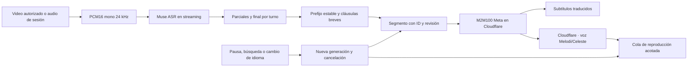

# 22. Traducción modular con Muse y un modelo de traducción Meta

27 de octubre de 2026 (informes UTC del 28). Ruta experimental integrada en
`/dubbing`, opción **Meta modular**, inicialmente inglés → español. Reutiliza
Muse y Cloudflare; no requiere otra clave. El primer ensayo real completo
entregó voz traducida a **5937 ms** desde el primer PCM de entrada. La inferencia
interna no fue expuesta y **el máximo de 500 ms sigue sin verificar**.

## Respuesta práctica

Muse ya entrega texto parcial mientras llega el audio. Ese texto puede alimentar
un modelo de traducción especializado sin pasar por la conversación de Spark.
Así se evita pedir a un modelo conversacional que construya una respuesta cuando
lo que se necesita es traducir una frase. La espera relevante pasa a depender de
cuándo hay texto suficientemente estable, cuánto tarda la traducción y, si se
activa doblaje, cuánto tarda la primera voz.

La opción inicial es **M2M100 de Meta alojado en Cloudflare Workers AI**, con la
configuración Cloudflare existente. Su endpoint traduce texto por petición
sincrónica: no es un WebSocket de traducción token a token. Una petición por cada
pequeña cláusula estable permite una experiencia continua por segmentos. La API
de conversación Spark mantiene su función de conversar y explicar con Melodi.
[Modelo y protocolo M2M100](https://developers.cloudflare.com/workers-ai/models/m2m100-1.2b/).

## Flujo implementado



La cadena desde el video hasta la traducción y la voz está conectada mediante
`ModularBridge`. Usa la voz Melodi/Celeste ya configurada. Cartesia y ElevenLabs
Flash son alternativas futuras para esta cadena; no están integradas como TTS
modular. Las rutas integrales Palabra y ElevenLabs se conservan como opciones
separadas, sin sustitución automática.

## Estado y límites de cada etapa

| Etapa | Estado al redactar | Qué comprueba y qué falta |
|---|---|---|
| Captura/PCM | AudioWorklet real, 24 kHz mono, bloques de 40 ms | Prueba integral local de UI/HTTP/WS sin micrófono; hardware físico pendiente |
| Muse | Relay real conectado; parciales y finales por turno | Ensayo real sintético completado; alineación semántica con video no medida |
| Segmentación estable | Cláusulas puntuadas estables entre actualizaciones; finales completan el resto | Heurística, no garantía de corrección; todavía puede esperar hasta el final si falta puntuación |
| M2M100 Cloudflare | Adaptador y acceso real comprobados | 1344 ms en texto aislado; 2907 ms dentro del ensayo integral; no son inferencia interna ni percentiles |
| Subtítulos | Reemplazo por ID/revisión y aviso de corrección | Deduplicación comprobada con API simulada; calidad bilingüe pendiente |
| TTS modular | Melodi/Celeste PCM progresivo integrado | Primer PCM TTS a 562 ms en el ensayo; Cartesia/Flash aún sin conectar |

La voz habitual de Melodi puede conservar su timbre y proveedor. Traducir el audio
de un video es otra tarea, con controles propios de original, doblaje y subtítulos.

## Transportar audio rápido no obliga a traducir cada paquete

Un bloque de PCM de 40–80 ms sirve para transporte y latencia de captura. No
contiene necesariamente una palabra completa ni una unidad traducible. Traducir
cada paquete produciría peticiones repetidas, poco contexto y voz con correcciones
imposibles de retirar después de escucharse.

La política actual acumula parciales y espera un prefijo puntuado que se mantiene
entre dos actualizaciones, o el final del turno. No implementa aún un corte por
tiempo para parciales sin puntuación. Cada unidad se limita a 400 caracteres;
se conserva contexto de deduplicación en memoria, no historial persistente.

Un prefijo estable es una heurística: un parcial puede corregirse después.
Los subtítulos provisionales se pueden reemplazar. Para voz conviene confirmar
una unidad antes de pronunciarla o aceptar explícitamente el riesgo de corrección.
Esperar siempre al final de toda la intervención sería más simple, pero reduce la
anticipación que busca esta función.

## Identidad, revisiones y cancelación

Cada sesión del navegador tiene una generación y conexión propias. Las unidades
llevan `turn_id`, `segment_id` y `revision`; la dirección está fijada a EN→ES.
No se han implementado marcas temporales por palabra ni una caché persistente
de traducciones. Las revisiones de mayúsculas/puntuación se normalizan para no
repetir un prefijo ya emitido.

- Un parcial nuevo reemplaza la propuesta anterior del mismo segmento.
- Una petición de traducción en curso puede terminar después de pausar o buscar;
  la generación vigente debe descartar esa salida.
- Una revisión anterior no puede sobrescribir un resultado más reciente.
- Lo ya hablado se registra como emitido para no duplicarlo. Una corrección
  posterior se muestra como tal; no se finge haber deshecho audio oído.
- Cambiar fuente, idioma o posición del video cancela traducción pendiente,
  solicitudes TTS y audio programado, e inicia una generación distinta.
- La cola tiene límites de duración y número de segmentos; si se atrasa demasiado,
  se conserva el estado retrasado o se detiene con una explicación.

Estas reglas pertenecen a Brivany. Una corrección semántica del prefijo actualiza
el subtítulo y avisa si la voz ya salió; la cola nueva del final se conserva. Si
no puede alinearse con suficiente confianza, la sesión se detiene explícitamente.
No se presenta esa heurística como comprensión garantizada del significado.

## Endpoint de traducción

```text
POST https://api.cloudflare.com/client/v4/accounts/<cuenta>/ai/run/@cf/meta/m2m100-1.2b
Authorization: Bearer <token solo en servidor>
Content-Type: application/json
```

```json
{"text":"A short complete clause.","source_lang":"en","target_lang":"es"}
```

Cloudflare documenta una respuesta completa por petición sincrónica. Ofrece
también ejecución batch, que tiene otra finalidad y no convierte esta ruta en
traducción de audio continua por sí sola. El adaptador debe validar la respuesta,
limitar texto y concurrencia, sanitizar errores y evitar reintentos automáticos.
[Referencia oficial](https://developers.cloudflare.com/workers-ai/models/m2m100-1.2b/).

Se usan los códigos `en` y `es` del esquema actual de parámetros. La misma página
conserva ejemplos con nombres completos; esa discrepancia no demuestra la causa
del rechazo HTTP observado.

Esta elección usa M2M100 por su función de traducción y disponibilidad alojada;
no presupone que un modelo distinto tenga la misma licencia o API. No hace falta
descargar modelos al ordenador ni iniciar una GPU Modal para este primer paso.

## Medir la pregunta «¿será demasiado lento?»

Las mediciones anteriores de Muse reconocieron tres frases sintéticas y dieron
un final a **285–368 ms después de la última actividad acústica** de cada muestra.
Ese dato es fin de reconocimiento después de terminar de hablar; no mide un
parcial desde que comienza una frase ni traduce audio. Las pruebas de reunión
mostraron que un parcial útil podía activar ayuda durante la pregunta, pero esa
ayuda recuperaba citas locales y no era traducción generada.
[Mediciones de voz](13-voz-live.md#medir-latencia),
[apoyo durante una pregunta](13-voz-live.md#apoyo-de-reunión-antes-del-final-de-la-pregunta).

Para esta nueva ruta se deben separar:

| Medición | Inicio y fin |
|---|---|
| Transporte/ASR parcial | Audio de referencia → primer parcial útil |
| Espera de estabilidad | Parcial útil → segmento elegido para traducir |
| Traducción observada | Envío de texto M2M100 → traducción completa recibida |
| Primera síntesis | Envío de texto traducido → primer PCM TTS recibido |
| Cola/reproducción | PCM recibido → instante programado para oírse |
| Retraso respecto al video | Fragmento original → traducción correspondiente, con método de alineación explícito |

Una única petición M2M100 con una frase corta puede resolver si la etapa de
traducción es funcional y cuánto tardó en esa muestra. Aunque terminase antes de
500 ms, eso no demostraría audio→doblaje completo en 500 ms, ni un máximo bajo
todas las cargas, ni inferencia interna del proveedor. Si esta última no se expone,
debe permanecer desconocida. El tiempo de red no se resta con una estimación para
inventar una métrica de inferencia.

Por tanto, sí tiene sentido construir esta ruta antes de declarar que se necesitan
otras tres cuentas. Puede mejorar control y reutilización; su velocidad real es
una pregunta de medición, no una promesa deducida del nombre “streaming”.

## Ensayo y estado verificado

`packages/providers/translation.py` limita cada segmento a 400 caracteres, valida
la salida, impide redirecciones con credenciales y no reintenta. Pasaron 131
pruebas Python del proyecto, incluyendo siete del adaptador y catorce del relay
modular. La UI pasó 24 escenarios con API/WS simulados en esa etapa. No miden
calidad del modelo. Las ampliaciones posteriores figuran en `VALIDACION.md`.

Se ejecutó una única petición EN→ES con texto sintético para comprobar acceso y
medir la etapa de traducción. Cloudflare la rechazó por HTTP (`mt_rejected`). El
informe `tmp/translation-measurements/20261028T000057-be1bca0e.json` está conservado
en la bitácora. No contiene traducción ni una latencia funcional válida; tampoco
permite atribuir la causa a credenciales, cuota o parámetros. Consumo facturado
desconocido. Posteriormente una consulta de catálogo de solo lectura confirmó
autenticación y modelo listado. Un único reensayo diagnóstico de texto produjo
traducción válida HTTP 200 en **1344 ms**; la causa del rechazo anterior sigue
sin poder atribuirse. Informe `tmp/translation-measurements/20261028T001027-fa3b6e22.json`.

La prueba integral local recorre interfaz, HTTP, WebSocket y AudioWorklet reales
con ASR/MT/TTS simulados: 101 paquetes PCM, dos traducciones y dos síntesis;
la traducción comenzó antes de terminar el video. Informe
`docs/verification-history/modular-pipeline-20261028T001455-1944393e.json`.

Un único ensayo integral real usó una frase inglesa sintética de **2,344 s**.
El primer PCM traducido llegó a **5937 ms**, con conexión previa de **672 ms**.
La petición MT tardó **2907 ms** y la petición TTS hasta primer PCM **562 ms**.
Hubo una petición MT y una TTS iniciadas; 3,56 s de voz de salida y cola de
reproducción estimada máxima de 435 ms. Informe
`tmp/dubbing-measurements/20261028T001543-4e4e5473.json`.

Es un resultado funcional, pero el retraso observado no cumple una experiencia
instantánea. No es una comparación controlada con las muestras distintas de
Palabra ni una distribución de latencias. No se midieron calidad bilingüe,
reproducción física, alineación semántica ni coste facturado. No se resta una
estimación de red para fabricar inferencia interna.

Después del ensayo se añadió un traductor con conexión HTTP/1.1 de alcance por
sesión. Las pruebas de loopback comprueban que dos segmentos reutilizan el mismo
socket y que cancelar impide otra petición; no se reenvía un POST fallido. No se
ha medido una mejora real con este transporte y no se atribuye ningún ahorro al
primer segmento. El lector en Windows puede terminar por su timeout antes de
liberar el turno, descartando el resultado cancelado.

También se añadieron tiempos de primer parcial Muse, primer segmento listo,
espera en cola y segmento listo → primer PCM. Los eventos MT llegan antes de
esperar TTS; las muestras no se duplican al emitir el resumen. Son límites
monotónicos locales que incluyen contexto/red; no métricas de inferencia interna.

## Presupuesto

Cloudflare publica **$0.342 por millón de tokens de entrada y $0.342 por millón de
tokens de salida** para M2M100. La fórmula de referencia es:

```text
coste_traducción_USD = (tokens_entrada + tokens_salida) × 0.342 / 1 000 000
```

No convertir caracteres en tokens con una relación fija para presentar una
factura. Usar el consumo declarado por la respuesta si existe y separar cuota
gratuita, tarifa publicada y cargo real. El coste Muse depende del acceso/modelo
habilitado y permanece desconocido si no está disponible en su uso o facturación.
TTS añade su propia unidad de cobro; los importes de Cartesia o Flash no incluyen
por sí solos transcripción y traducción.
[Tarifa M2M100](https://developers.cloudflare.com/workers-ai/models/m2m100-1.2b/),
[comparación por unidades de la cadena alternativa](21-costes-cadena-doblaje.md).

Cada ensayo externo se limita a una muestra con propósito concreto. La sesión
modular tiene un máximo de 60 s, 24 peticiones MT+TTS combinadas, cuatro segmentos
pendientes y 12 s para terminar tras el audio de entrada. No hay reintentos
automáticos. Las demás comprobaciones serán locales hasta que
otra llamada resuelva un fallo o decisión concreta. Guardar en la bitácora modelo,
tiempos, consumo conocido y límites; no claves, audio original ni texto privado.
