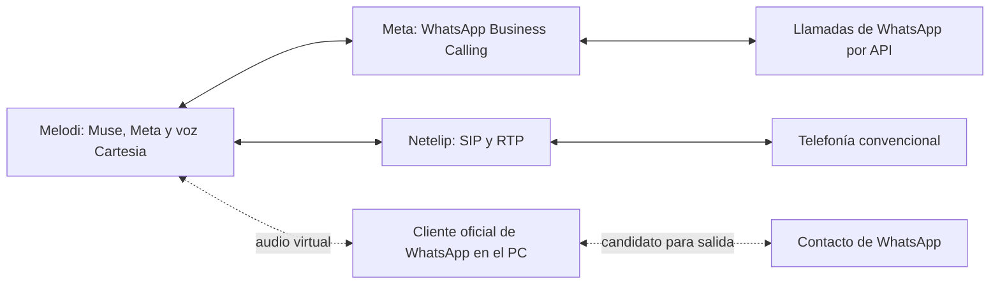

# Alternativa para llamadas salientes de WhatsApp

Investigación del 8 de noviembre de 2026, posterior a la auditoría de agenda.
El usuario definió esta arquitectura: API de Meta y WhatsApp Business para las
llamadas de WhatsApp, y Netelip para llamadas telefónicas directas entrantes
y salientes. Pidió buscar una salida de WhatsApp de coste mínimo, preferiblemente
sin pago y sin solicitar permiso técnico previo a cada destinatario.

## Conclusión

No se encontró una API oficial de llamadas salientes de WhatsApp que elimine
la autorización del destinatario. La conexión directa a Meta y el cambio de
intermediario mantienen ese requisito. Meta lo describe en su
[anuncio de Calling API](https://whatsappbusiness.com/blog/whatsapp-business-calling-api/).

Hay una **alternativa candidata para un prototipo personal en el PC**:
usar las llamadas del cliente oficial de WhatsApp y conectar su audio a Melodi.
La [ayuda oficial de WhatsApp para Windows](https://faq.whatsapp.com/1153602608602452/?cms_platform=windows-desktop&locale=es_LA)
describe llamadas gratuitas por Internet mediante el botón de llamada del chat.
Ese flujo de llamada normal no describe una solicitud previa de permiso de
Calling API. La persona debe poder recibir la llamada y contestarla.

**Inferencia de ingeniería:** sería posible estudiar un adaptador que controle
el cliente oficial y use un dispositivo de audio virtual para que Melodi escuche
y responda. Las fuentes anteriores acreditan llamadas del cliente; no acreditan
que ese adaptador exista, esté soportado como automatización ni funcione todavía
con la cuenta del usuario. No se declara implementado ni listo para llamadas.

## Arquitectura que se conserva

La tercera rama está en estudio. No modifica las dos vías elegidas por el usuario.
Para recibir telefonía convencional mediante Netelip hace falta numeración o una
ruta de entrada contratada/configurada; disponer de credenciales SIP de salida
no acredita que las llamadas al móvil actual lleguen a Melodi.
[Requisitos de la Línea SIP](https://www.netelip.com/centro-de-ayuda/linea-sip/preguntas-frecuentes/).

## Audio y control propuestos

1. La interfaz de Brivany prepara el destino y muestra la llamada concreta.
2. El adaptador abre el contacto y acciona la llamada en el cliente oficial.
3. La voz Cartesia se entrega al micrófono virtual seleccionado por WhatsApp.
4. El audio de WhatsApp se captura de forma aislada y se entrega a Muse.
5. La conversación usa el mismo proveedor Meta, interrupciones y cierre de Melodi.

Microsoft publica una [muestra de captura de audio por proceso con WASAPI](https://learn.microsoft.com/en-us/samples/microsoft/windows-classic-samples/applicationloopbackaudio-sample/).
Permite estudiar el aislamiento del audio de la aplicación, sin usar el sonido
global del equipo. Hay que comprobar la separación real entre interlocutor,
voz de Melodi y otros sonidos para evitar eco o que se escuche a sí misma.

Como opción para el micrófono virtual, [VB-CABLE](https://vb-audio.com/Cable/)
ofrece un controlador de audio bajo modalidad donationware. No se instaló ni
se descargó. Su instalación requiere administración y reinicio; una distribución
con Brivany necesitaría revisar su licencia. No se presupone coste cero para
componentes adicionales ni se ofrece una solución comercial empaquetada.

Meta también anunció [llamadas en WhatsApp Web](https://about.fb.com/news/2026/07/whatsapp-web-calling-new-features/).
Puede estudiarse como cliente alternativo. Deben comprobarse la disponibilidad
en la cuenta y el aislamiento de audio del navegador. No se ha medido el consumo
de ninguna de estas variantes ni se declara una ventaja de CPU o memoria.

## Coste y límites

| Aspecto | Estado comprobado o pendiente |
| --- | --- |
| Minutos de llamadas normales del cliente WhatsApp | La ayuda oficial los describe como gratuitos por Internet. |
| Modelo y voz de Melodi | Mantienen el consumo de los proveedores existentes. No se promete coste total cero. |
| Equipo y conexión | El PC y el cliente deben estar disponibles; la red y el alojamiento, si se añaden, tienen su propio coste. |
| Automatización desde Brivany | Hipótesis pendiente de prototipo, soporte y compatibilidad con el cliente. |
| Número ya registrado en Meta | Falta comprobar si admite uso en aplicación y con qué modalidad de cuenta. No iniciar sesión ni migrarlo suponiendo que sean intercambiables. |
| Disponibilidad del destinatario | La cuenta y sus ajustes deben permitir recibir la llamada. No se promete alcanzar a cualquier usuario. |
| Estabilidad y latencia | Sin medir. Cambios de interfaz o dispositivos podrían afectar el adaptador. |

La coexistencia de aplicación Business y Cloud API tiene requisitos propios.
La [documentación del proveedor 360dialog](https://docs.360dialog.com/partner/onboarding/whatsapp-coexistence)
describe restricciones de incorporación y dispositivos vinculados. Es una señal
concreta de que no debe darse por hecho el uso simultáneo del número API en el
cliente normal; la elegibilidad de la cuenta Meta directa sigue por verificar.
No se propone contratar ese proveedor ni migrar el número.

## Comprobación local de esta investigación

Se leyeron los nombres de los dispositivos de audio presentes en Windows.
Aparecieron los endpoints Realtek y FxSound; no apareció un endpoint VB-CABLE.
La consulta de instalación Appx de WhatsApp falló por incompatibilidad del módulo
con el entorno de ejecución. No se pudo confirmar su instalación con esa consulta.
La ausencia de un proceso WhatsApp en ejecución tampoco demuestra que no esté
instalado. Estas comprobaciones son inventario, no una prueba de llamada o audio.

No hubo captura de audio, inicio de sesión, modificación de cuenta, instalación,
descarga de modelo, llamada pública, mensaje ni solicitud a APIs de IA.

## Criterio para validar el candidato

Primero comprobar una sesión compatible del cliente sin alterar el número API;
después, un circuito de audio sintético de ida y vuelta, selección persistente
de dispositivos, silencio, interrupción, cancelación y cierre sin capturar otras
aplicaciones. Solo si esos pasos pasan tendría sentido una llamada real autorizada.
El usuario mantiene las pruebas reales para una fase posterior.

La automatización y la calidad de conversación continúan pendientes. Este
estudio no corrige la falta de agenda en llamadas encontrada en la
[auditoría anterior](melodi-agenda-whatsapp-auditoria-20261108.md).

## Implementación posterior

El usuario autorizó construir el candidato y probarlo en simulación. Se entregaron
el canal, la pasarela y los adaptadores; la prueba con WhatsApp real sigue pendiente.
[Implementación y evidencias](melodi-whatsapp-cliente-implementacion-20261108.md).
